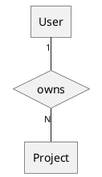
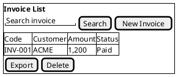

# Per-kind skeletons — source: Phases §7; srs-spine.md §7.1

## `context` — §1 System Context

Source fields: `project.system_name ?? project.name` · `actors[].name/.kind/.flows_in/.flows_out`. Engine `svg` (no PlantUML source): level-0 data flow in Yourdon/DeMarco notation — ONE circle for the whole system, one rectangle per external actor (fill `#7ACFF5`, role name inside), people on the left half and external systems / scheduler on the right half. Every `flows_in` item (actor → system) and every `flows_out` item (system → actor) is its own straight arrow with a solid head and one Title Case data-noun label along it on white; no limit, no merging, no unlabelled arrows, no data stores, no flows between entities, no title. One-way actors draw only the arrows that exist — never pair lists by index or invent a counterpart — but the diagram as a whole always has both directions; missing flows get a fallback label by kind. See `renderer/context` for the full rules.

## `usecase` — §2.2.1 (+ actor hierarchy §2.1)

Source fields: `actors[].name/.kind/.parent_id` · `use_cases[].name/.actor_ids/.function_ids/.includes/.extends` · `functions[].feature_id` · `features[].name/.order`.

Engine `svg` (no PlantUML source): UML 2.5.1 built in code, fill `#7ACFF5`.

- One system boundary named `project.system_name ?? project.name`; every use case an ellipse of the same size in one column.
- Actor = stick figure, human on the left, `system`/`time` on the right (`<<system>>` / `<<time>>`), outside the boundary; abstract actors (with children) in italic.
- Association = solid straight line, no arrowhead. `includes[]` → `base ..> included : <<include>>`; `extends[]` → `extension ..> base : <<extend>>` — dashed, open arrowhead, vertical between adjacent ellipses.
- One diagram per feature (`function_ids` → `functions[].feature_id`, several ⇒ the first function's feature); no feature ⇒ grouped by main actor after the features. Over 20 use cases ⇒ split equally in the same feature; `owner_kind` / `owner_id` stay `null`, the first part keeps the original id.
- Actors as modelled: general actors stay general, never expanded to leaf actors. A human actor skips the edge to a use case that is included / extending in the same diagram; `system`/`time` actors keep every edge.
- `actors[].parent_id` (human → human) ⇒ one extra diagram (`section = fixed:2.1`): actor hierarchy, child below parent, solid line, hollow triangle at the parent. Use cases have no parent field ⇒ no use case generalization.
- Layout rules and algorithm: `renderer/usecase/SKILL.md`, `docs/technical/usecase-diagram-layout.md`.

## `screen_flow` — §3.1.1

Source fields: `screens[].name/.flow_to/.is_popup/.tabs` + the human actor each screen serves.

**Graphviz DOT, not a state diagram**: the flow starts at a diamond with the actor name inside, and a
PlantUML state diagram cannot label a diamond. One part per human actor that uses the UI (graph label
`Screens flow for <actor>`, also the image caption), holding only that actor's screens and the edges between
them. No part for unassigned screens: a public screen (granted only to a role with no actor, e.g. Guest on
Login) is drawn in every human actor's part; a public landing page and Register are entries beside Login
(Login stays an entry despite `Register → Login`); any other
screen no human actor uses is not drawn and raises `orphan_screen`. Before any screen ↔ actor link exists: one unlabelled diagram, black-dot start. Arrows are
one-way: of a pair pointing at each other only the forward edge (away from the entry) is drawn.

```
@startdot
digraph screens_flow {
  graph [fontname="DejaVu Sans", fontsize=13, labelloc=t, compound=true, nodesep=0.4, ranksep=0.5];
  node [fontname="DejaVu Sans", fontsize=11, shape=box, color="#000000"];
  edge [arrowsize=0.8];
  label="Screens flow for Founder";
  START [label="Founder", shape=diamond, style=solid];
  S1 [label="Login"];
  S2 [label="Project Dashboard"];
  subgraph cluster_S3 {
    label="Project Workspace"; style=solid;
    S3_T1 [label="Chat"];
    S3_T2 [label="Document"];
  }
  S4 [label="Confirm Delete", shape=ellipse];
  START -> S1;
  S1 -> S2;
  S2 -> S3_T1 [lhead=cluster_S3];
  S2 -> S4;
}
@enddot
```

- Screens with `tabs[]` → `subgraph cluster_<screen>`, one node per tab (`<screen>_T<n>`); edges attach to
  `_T1` with `lhead` / `ltail`.
- Screen = rectangle (`shape=box`); `is_popup = true` → oval (`shape=ellipse`), name only (no `(pop-up)` text). Shapes are not filled (PlantUML drops the border of a
  `rounded,filled` node). Font `DejaVu Sans` is required — the default dot font is missing in the image.

## `erd` — §3.1.5

Source fields: `entities[].name/.relations/.relation_verbs/.relation_cardinality/.relation_optional`. Attributes are **not** drawn (not in source fields).
Chen notation: entity = rectangle, each relation = a diamond holding a lowercase verb (`relation_verbs`, `has`
when missing). Braces after `entity` / `relationship` are required even when empty.



Cardinality labels on the lines: `-1-` one · `-N-` many · `-(0,1)-` optional one. The parent side is `1`, or `(0,1)` when the child is in `relation_optional` (never `-0..1-`: a syntax error in `@startchen`); the child side is `relation_cardinality[<child>]`, `N` when missing.

## `screen_layout` — §3.x.y (core screens only, Phases §7.2)

Source fields: `screens[<owner>].name` · `functions[screen_id=<owner>].name/.description`. Attached to `screens[].primary_function_id`.



- Low-fi on purpose: what the screen has and does, not how it looks.
- Repeated CRUD admin screens: one template salt + a variant table, not one salt each.
- `@startsalt … @endsalt` replaces `@startuml … @enduml` for this kind only.
