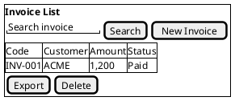

# Per-kind skeletons - source: Phases §7; srs-spine.md §7.1

## `context` - §1 System Context

Source fields: `project.system_name ?? project.name` · `actors[].name/.kind/.flows_in/.flows_out`. Engine `svg` (no PlantUML source): level-0 data flow in Yourdon/DeMarco notation - ONE circle for the whole system, one rectangle per external actor (fill `#7ACFF5`, role name inside), people on the left half and external systems / scheduler on the right half. Every `flows_in` item (actor → system) and every `flows_out` item (system → actor) is its own straight arrow with a solid head and one Title Case data-noun label along it on white; no limit, no merging, no unlabelled arrows, no data stores, no flows between entities, no title. One-way actors draw only the arrows that exist - never pair lists by index or invent a counterpart - but the diagram as a whole always has both directions; missing flows get a fallback label by kind. See `renderer/context` for the full rules.

## `usecase` - §2.2.1 (+ actor hierarchy §2.1)

Source fields: `actors[].name/.kind/.parent_id` · `use_cases[].name/.actor_ids/.function_ids/.includes/.extends` · `functions[].feature_id` · `features[].name/.order`.

Engine `svg` (no PlantUML source): UML 2.5.1 built in code, fill `#7ACFF5`.

- One system boundary named `project.system_name ?? project.name`; every use case an ellipse of the same size in one column.
- Actor = stick figure, human on the left, `system`/`time` on the right (`<<system>>` / `<<time>>`), outside the boundary; abstract actors (with children) in italic.
- Association = solid straight line, no arrowhead. `includes[]` → `base ..> included : <<include>>`; `extends[]` → `extension ..> base : <<extend>>` - dashed, open arrowhead, vertical between adjacent ellipses.
- One diagram per feature (`function_ids` → `functions[].feature_id`, several ⇒ the first function's feature); no feature ⇒ grouped by main actor after the features. Over 20 use cases ⇒ split equally in the same feature; `owner_kind` / `owner_id` stay `null`, the first part keeps the original id.
- Actors as modelled: general actors stay general, never expanded to leaf actors. A human actor skips the edge to a use case that is included / extending in the same diagram; `system`/`time` actors keep every edge.
- `actors[].parent_id` (human → human) ⇒ one extra diagram (`section = fixed:2.1`): actor hierarchy, child below parent, solid line, hollow triangle at the parent. Use cases have no parent field ⇒ no use case generalization.
- Layout rules and algorithm: `renderer/usecase/SKILL.md`, `docs/technical/usecase-diagram-layout.md`.

## `screen_flow` - §3.1.1

Source fields: `screens[].name/.flow_to[].to/.is_popup/.tabs/.feature_id/.queue_order` · `features[].order` · the actors of each screen (screen → `primary_function_id` → function → use case → `actor_ids`; `actors[].parent_id`).

Engine `svg` (no PlantUML source): the notation of the FPT SRS template §3.1.1 sample, built in code.

- One diagram for the whole system; over 40 screens (or failing the layout check) ⇒ split by whole features, `Screens flow (i/n)`. `owner_kind` / `owner_id` stay `null`, the first part keeps the original id.
- Screen = square-cornered rectangle; pop-up = oval; screen with tabs = frame with one italic box per tab. Fill `#7ACFF5` for a screen every leaf human actor uses (template yellow), white otherwise. No swimlanes, no edge labels, no decision diamonds, no start / end nodes.
- Navigation = solid orthogonal line, small filled triangle arrowhead, one per forward `flow_to` edge (of a pair pointing at each other only the edge away from the entry; return navigation implicit). Several targets in the next column share one trunk. Every screen is drawn; no actor ⇒ flag `orphan_screen`. Full rules: `renderer/screen-flow/SKILL.md`.

## `erd` - §3.1.5

Source fields: `entities[].name/.relations/.relation_verbs/.relation_cardinality/.relation_optional/.attributes` + the project's notation (`Project.erdNotation`, outside the Spine). Attributes: `key` ⇒ PK, `reference` ⇒ FK in Crow's foot / IDEF1X boxes; in Chen, ovals for key (underlined) and plain attributes only - no oval for `reference` (the diamond is the relationship).
Engine `svg` (no PlantUML source): built in code, fill `#7ACFF5`, one shared grid placer + right-angle router for all three notations (`erd.renderer.ts`, `erd-layout.ts`, `orthogonal-*.ts`). One notation per document: `chen` (default) · `crowsfoot` · `idef1x`. Changing it redraws the diagram (hash includes the notation).

Data → diagram: entity = box with its singular-noun name; relation = parent → child, labelled by `relation_verbs` (`has` when missing). Parent end `1`, or `0..1` when the child is in `relation_optional`; child end `N` (many, default) or `1` per `relation_cardinality`, minimum drawn as 0.

| | Relation | Parent end | Child end |
| --- | --- | --- | --- |
| Chen | diamond holding the verb, entity - diamond - entity | label `1`, single line | label `N` / `1`; double line = total participation (child not optional) |
| Crow's foot | one line, verb on the line | `\|\|` one · `\|o` zero or one | crow's foot + ring `o{` · bar + ring `\|o` for one |
| IDEF1X | dashed line (non-identifying), verb on the line; entity rounded only when dependent | hollow diamond when optional | solid dot; `Z` for one-to-one |

Lines: straight when clear, otherwise right-angle bends (L / Z / U); never over text or shapes, never overlapping; right-angle crossings only. More than 25 entities ⇒ split (connected components packed, a larger one cut breadth-first, relations across a cut not drawn), title `Entity Relationship Diagram (i/n)`, first part keeps the diagram id. Samples: `docs/diagram_guideline/erd/`.

## `class` - §3.x (head of each feature section)

Source fields: `entities[].name/.attributes/.feature_ids/.relations/.relation_verbs/.relation_cardinality/.relation_optional` · `features[].name/.order`. Domain (analysis) level, IEEE 830 Annex A.3 (organised by object); the design-level class diagram of Report 4 (IEEE 1016) is a different artifact.
Engine `svg` (no PlantUML source): UML 2.5.1 class built in code, fill `#7ACFF5`, same grid placer + right-angle router as the ERD (`class.renderer.ts`, `class-layout.ts`).

- One diagram per feature (`owner_kind = feature`, `owner_id` = feature id, `section = feature:<id>`); an entity of several features appears in each. Only relations between classes of the same diagram are drawn. Entity without `feature_ids` ⇒ no class diagram. Over 25 classes ⇒ split (`Class Diagram - <feature> (i/n)`).
- Class box = 2 compartments: bold name, attributes. No operations, no data types, no stereotype. Attribute `name`, plus `{id}` (key), `{ref}` (reference), `[0..1]` (not required).
- Relation = association (solid line, no arrowhead): multiplicity at both ends (parent `1` or `0..1` from `relation_optional`; child `*` for `N`, `0..1` for `1`) and the verb as association name. Aggregation (hollow diamond at the whole), composition (filled diamond), generalization (hollow triangle at the parent) are drawn when the source says so; the Spine has no such data yet, so none is generated.
- Layout as ERD: straight when clear, right-angle bends otherwise, no line over text or shapes. Full rules: `renderer/class/SKILL.md`; samples `docs/diagram_guideline/class/`.

## `state_machine` - §3.1.5 (next to the entity description)

Source fields: `entities[].name/.states[].id/.name/.initial/.final` · `entities[].transitions[].from/.to/.event/.guard/.action`. Lifecycle of one entity, IEEE 830 Annex A.1 (organised by mode); drawn only for an entity that has states.
Engine `svg` (no PlantUML source): UML 2.5 State Machine built in code, fill `#7ACFF5` (`state-machine.renderer.ts`, `state-machine-layout.ts`).

- One diagram per entity that has `states[]` (`owner_kind = entity`, `owner_id` = entity id, `section = fixed:3.1.5`); title `State Machine Diagram - <entity>`. Not split.
- Initial = solid dot with an open arrow to the `initial` state; final = bullseye (ring + solid core) with an open arrow from each `final` state; state = rounded rectangle, bold name inside. State names are adjectives or participles (Pending, Approved), never actions.
- Transition = one straight solid line with an open arrowhead, label `event [guard] / action` (guard / action omitted when empty). Several transitions between the same two states (either direction) are parallel segments. A self-transition (`from = to`) is an internal transition: its label is a line in a lower compartment of the state.
- Layout: states by BFS layer from the initial state, several candidate arrangements (and a circle) tried; the first with no line over a shape or text and the fewest crossings wins. Full rules: `renderer/state-machine/SKILL.md`; samples `docs/diagram_guideline/state-machine/`.

## `sequence` - §3.x.y (function detail)

Source fields: `functions[<owner>].name/.screen_id/.interactions[].from/.to/.message/.kind/.flow/.guard` · `actors[].name/.kind` of the ends of each message. System Sequence Diagram (black box), IEEE 830 Annex A.4 (stimulus / response sequence); the design-level sequence (Controller → Service → Repository) of Report 4 is a different artifact.
Engine `puml` (PlantUML server): UML 2.5 Sequence from `sequence.renderer.ts`, Visual Paradigm theme inlined, fill `#7ACFF5`.

- One diagram per function that needs one (`owner_kind = function`, `owner_id` = function id, `section = function:<id>`). It needs one when it has at least 2 `interactions` and (a non-human actor takes part, or a message is `abnormal` or has a `guard`, or the function has no screen). Otherwise no diagram.
- Lifelines: human actors (stick figure), `:System`, external `system` / `time` actors; exact actor names, generalization kept, nothing else (no Frontend / Backend / Repository).
- Message: request with a response back to the sender ⇒ synchronous solid arrow with a filled triangle head (`->` + `skinparam style strictuml`) + activation bar; request without ⇒ asynchronous open arrow (`->>`); response ⇒ dashed open arrow (`-->>`). Labels numbered `1:`, `1.1:`, `1.2:`, `2:` (stimulus = request from an actor).
- `abnormal` ⇒ `alt <guard>` / `else <guard>`, the normal flow after it is the last `else`; `normal` with `guard` ⇒ `opt <guard>`; no `loop` (no data yet).
- Messages carry data in plain words (`Submit email and password`), not method calls; the Spine writes them (S-5.4 `function-detail`). Samples: `docs/diagram_guideline/sequence/`; full rules: `renderer/sequence/SKILL.md`.

## `activity` - §3.x (Functions: feature of the use case)

Source fields: `use_cases[<owner>].name/.activity_nodes[].id/.kind/.name/.lane/.activity_flows[].from/.to/.guard` · `actors[].name` of the lanes. Processing flow of one use case, UML 2.5 Activity Diagram with swimlanes. Not in the FPT template unless the user asks; an IEEE template has it under each use case in Functions.
Engine `svg` (no PlantUML source): built in code, fill `#7ACFF5` (`activity.renderer.ts`, `activity-layout.ts`, swimlane layout from FLF-340).

- One diagram per use case that has `activity_nodes[]` (`owner_kind = use_case`, `owner_id` = use case id, `section = feature:<id>` of the use case's feature, else `fixed:2.2.2`); title `Activity Diagram - <use case>`. Not split.
- Initial = solid dot; activity final = bullseye; action = rounded rectangle with a verb phrase; decision = diamond (a flat hexagon holding the question when `name` is set); merge = diamond; fork / join = thick black bar; control flow = solid line, open arrowhead, `[guard]` on the line.
- Lanes = `lane` of the nodes (actor id ⇒ exact actor name, `system` ⇒ System); a node without a lane sits in the lane of its predecessor. No lane anywhere ⇒ no lane frames.
- Orthogonal lines; a loop back to an earlier node goes up a gutter. Full rules: `renderer/activity/SKILL.md`.

## `deployment` - IEEE "Distribution" (`slot:distribution`) / FPT §4.1 on request

Source fields: `deployment_nodes[].id/.name/.kind/.parent_id/.artifacts/.components` · `deployment_links[].from/.to/.protocol`. Physical placement of the software on hardware nodes (IEEE 830 §3.1 hardware / software / communication interfaces).
Engine `puml` (PlantUML server): UML 2.5 Deployment from `deployment.renderer.ts`, Visual Paradigm theme inlined, node fill `#7ACFF5`, `left to right direction`.

- One diagram for the system (`owner_kind = null`, `section = fixed:4.1`), title `Deployment Diagram`; no nodes ⇒ no diagram. Printed under "Distribution" of "Design and Implementation" in an IEEE template (inserted when the file has no such heading); in the FPT template only when the user asked, under §4.1.
- Node = 3D box: `<<device>>` hardware, `<<executionEnvironment>>` runtime / OS / container / DBMS nested in its device, plain `node` otherwise; components and artifacts drawn inside their node; communication path = solid line without arrowhead labelled with the protocol.
- Full rules and the Visual Paradigm principles: `renderer/deployment/SKILL.md`.

## `screen_layout` - §3.x.y (core screens only, Phases §7.2)

Source fields: `screens[<owner>].name` · `functions[screen_id=<owner>].name/.description`. Attached to `screens[].primary_function_id`.

- Low-fi on purpose: what the screen has and does, not how it looks.
- Repeated CRUD admin screens: one template salt + a variant table, not one salt each.
- `@startsalt … @endsalt` replaces `@startuml … @enduml` for this kind only.
