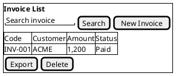

# Per-kind skeletons — source: Phases §7; srs-spine.md §7.1

## `context` — §1 System Context

Source fields: `project.system_name ?? project.name` · `actors[].name/.kind/.flows_in/.flows_out`. Engine `svg` (no PlantUML source): level-0 data flow in Yourdon/DeMarco notation — ONE circle for the whole system, one rectangle per external actor (fill `#7ACFF5`, role name inside), people on the left half and external systems / scheduler on the right half. Every `flows_in` item (actor → system) and every `flows_out` item (system → actor) is its own straight arrow with a solid head and one Title Case data-noun label along it on white; no limit, no merging, no unlabelled arrows, no data stores, no flows between entities, no title. One-way actors draw only the arrows that exist — never pair lists by index or invent a counterpart — but the diagram as a whole always has both directions; missing flows get a fallback label by kind. See `renderer/context` for the full rules.

## `usecase` — §2.2.1 (+ actor hierarchy §2.1)

Source fields: `actors[].name/.kind/.parent_id` · `use_cases[].name/.actor_ids/.function_ids/.includes/.extends` · `functions[].feature_id` · `features[].name/.order`.

Engine `svg` (no PlantUML source): UML 2.5.1 built in code, fill `#7ACFF5`.

- One system boundary named `project.system_name ?? project.name`; every use case an ellipse of the same size in one column.
- Actor = stick figure, human on the left, `system`/`time` on the right (`<<system>>` / `<<time>>`), outside the boundary; abstract actors (with children) in italic.
- Association = solid straight line, no arrowhead. `includes[]` → `base ..> included : <<include>>`; `extends[]` → `extension ..> base : <<extend>>` — dashed, open arrowhead, vertical between adjacent ellipses.
- One diagram per feature (`function_ids` → `functions[].feature_id`, several ⇒ the first function's feature); no feature ⇒ grouped by main actor after the features. Over 20 use cases ⇒ split equally in the same feature; `owner_kind` / `owner_id` stay `null`, the first part keeps the original id.
- Actors as modelled: general actors stay general, never expanded to leaf actors. A human actor skips the edge to a use case that is included / extending in the same diagram; `system`/`time` actors keep every edge.
- `actors[].parent_id` (human → human) ⇒ one extra diagram (`section = fixed:2.1`): actor hierarchy, child below parent, solid line, hollow triangle at the parent. Use cases have no parent field ⇒ no use case generalization.
- Layout rules and algorithm: `renderer/usecase/SKILL.md`, `docs/technical/usecase-diagram-layout.md`.

## `screen_flow` — §3.1.1

Source fields: `screens[].name/.flow_to[].to/.trigger/.guard/.is_popup/.tabs/.feature_id` · `features[].name/.order` · `actors[].name/.parent_id` + the actor of each screen (screen → `primary_function_id` → function → use case → `actor_ids`).

Engine `svg` (no PlantUML source): UML 2.5 Activity Diagram with swimlanes built in code, fill `#7ACFF5`.

- One diagram per feature; over 25 screens ⇒ split equally (`<feature> (1/2)`). `owner_kind` / `owner_id` stay `null`, the first part keeps the original id. Screens whose feature does not exist go to a last group.
- Swimlane = the actor performing the screen, exact actor name in the lane header; general actor kept (several actors with a common ancestor ⇒ the ancestor's lane), never expanded to leaf actors. Ambiguous actors (no common ancestor) ⇒ first actor + yellow flag `screen_actor_ambiguous`. No actor ⇒ screen not drawn (`orphan_screen`). No link at all yet ⇒ no lane frames.
- Screen = action (rounded rectangle); pop-up = action with stereotype `<<pop-up>>`; tabs = line `[tab | tab]` under the name. Initial node (solid dot) above each entry screen, activity final (ring + dot) below each ending screen.
- Control flow = solid line, open arrowhead, one per `flow_to` edge inside the diagram (forward only: of a pair pointing at each other only the edge away from the entry; return navigation implicit). Straight, or orthogonal bends when a straight line would cross a shape.
- `trigger` = horizontal label on the arrow; edges of one screen with the same trigger, ≥ 2 and some `guard` ⇒ decision node (filled `#7ACFF5` diamond), trigger on screen → diamond, `[guard]` / `[else]` on each branch. Full rules: `renderer/screen-flow/SKILL.md`.

## `erd` — §3.1.5

Source fields: `entities[].name/.relations/.relation_verbs/.relation_cardinality/.relation_optional/.attributes` + the project's notation (`Project.erdNotation`, outside the Spine). Attributes: `key` ⇒ PK, `reference` ⇒ FK in Crow's foot / IDEF1X boxes, ovals in Chen (key underlined).
Engine `svg` (no PlantUML source): built in code, fill `#7ACFF5`, one shared grid placer + right-angle router for all three notations (`erd.renderer.ts`, `erd-layout.ts`, `orthogonal-*.ts`). One notation per document: `chen` (default) · `crowsfoot` · `idef1x`. Changing it redraws the diagram (hash includes the notation).

Data → diagram: entity = box with its singular-noun name; relation = parent → child, labelled by `relation_verbs` (`has` when missing). Parent end `1`, or `0..1` when the child is in `relation_optional`; child end `N` (many, default) or `1` per `relation_cardinality`, minimum drawn as 0.

| | Relation | Parent end | Child end |
| --- | --- | --- | --- |
| Chen | diamond holding the verb, entity — diamond — entity | label `1`, single line | label `N` / `1`; double line = total participation (child not optional) |
| Crow's foot | one line, verb on the line | `\|\|` one · `\|o` zero or one | crow's foot + ring `o{` · bar + ring `\|o` for one |
| IDEF1X | dashed line (non-identifying), verb on the line; entity rounded only when dependent | hollow diamond when optional | solid dot; `Z` for one-to-one |

Lines: straight when clear, otherwise right-angle bends (L / Z / U); never over text or shapes, never overlapping; right-angle crossings only. More than 25 entities ⇒ split (connected components packed, a larger one cut breadth-first, relations across a cut not drawn), title `Entity Relationship Diagram (i/n)`, first part keeps the diagram id. Samples: `docs/diagram_guideline/erd/`.

## `class` — §3.x (head of each feature section)

Source fields: `entities[].name/.attributes/.feature_ids/.relations/.relation_verbs/.relation_cardinality/.relation_optional` · `features[].name/.order`. Domain (analysis) level, IEEE 830 Annex A.3 (organised by object); the design-level class diagram of Report 4 (IEEE 1016) is a different artifact.
Engine `svg` (no PlantUML source): UML 2.5.1 class built in code, fill `#7ACFF5`, same grid placer + right-angle router as the ERD (`class.renderer.ts`, `class-layout.ts`).

- One diagram per feature (`owner_kind = feature`, `owner_id` = feature id, `section = feature:<id>`); an entity of several features appears in each. Only relations between classes of the same diagram are drawn. Entity without `feature_ids` ⇒ no class diagram. Over 25 classes ⇒ split (`Class Diagram — <feature> (i/n)`).
- Class box = 2 compartments: bold name, attributes. No operations, no data types, no stereotype. Attribute `name`, plus `{id}` (key), `{ref}` (reference), `[0..1]` (not required).
- Relation = association (solid line, no arrowhead): multiplicity at both ends (parent `1` or `0..1` from `relation_optional`; child `*` for `N`, `0..1` for `1`) and the verb as association name. Aggregation (hollow diamond at the whole), composition (filled diamond), generalization (hollow triangle at the parent) are drawn when the source says so; the Spine has no such data yet, so none is generated.
- Layout as ERD: straight when clear, right-angle bends otherwise, no line over text or shapes. Full rules: `renderer/class/SKILL.md`; samples `docs/diagram_guideline/class/`.

## `screen_layout` — §3.x.y (core screens only, Phases §7.2)

Source fields: `screens[<owner>].name` · `functions[screen_id=<owner>].name/.description`. Attached to `screens[].primary_function_id`.

- Low-fi on purpose: what the screen has and does, not how it looks.
- Repeated CRUD admin screens: one template salt + a variant table, not one salt each.
- `@startsalt … @endsalt` replaces `@startuml … @enduml` for this kind only.
